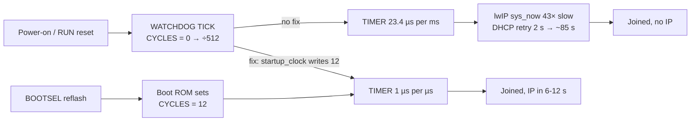

# PF-001: the TIMER runs 43× slow after a power-on, so DHCP never completes

> [!IMPORTANT]
> **Claim.** On a power-on or RUN-pin reset, `startup_clock()` leaves the RP2040
> watchdog tick generator at its reset value. The TIMER block (`time_us_64()`,
> lwIP `sys_now()`, CYW43 timeouts) then runs at 12 MHz ÷ 512 instead of
> 1 MHz, i.e. **23.4375 µs per ms, ~43× slow**. With Wi-Fi the board joins the
> network but never gets an IP address. This is a clock-setup fault in the port,
> not a TCP/IP bug. A one-line register write fixes it.

| | |
|---|---|
| Fix (proposed for merge) | branch `fix/pf001-watchdog-tick`, commit [`84efce7`](https://github.com/Azzahabie/mtk3smp-rp2040/commit/84efce7b5dc3ecbbef57ace3fb7add2ca3baf61e): one register write in `startup_clock()` |
| Evidence (not for merge) | this branch, `test/pf001-evidence`: test code + these docs + raw logs |
| Tested source | upstream `main` @ [`2e8e6ad`](https://github.com/Azzahabie/mtk3smp-rp2040/tree/2e8e6ad480c2d84a369b12995694b9bf5e9ddfb3), unmodified apart from the test code |
| Board | Raspberry Pi Pico W (RP2040 + CYW43439) on a Pico maker board |
| Total boots logged | 109 |

> [!TIP]
> **To reproduce:** see [REPRODUCE.md](REPRODUCE.md). It covers prebuilt images
> (about 5 minutes, no build needed), building the test images, and building
> `main` vs the fix branch with Wi-Fi.

## Headline result: Wi-Fi + DHCP on a router (run 4)

Every boot below has its boot path printed by the board itself (see
[METHOD.md](METHOD.md#reading-the-done-line)).

| Image | Boot path | Boots | TIMER rate | Joined (`link UP`) | IP within 60 s | PC → Pico ping |
|---|---|---|---|---|---|---|
| no fix | reflash (BOOTSEL) | 10 | ~1000 µs/ms | 10/10 | 10/10 | ✅ |
| no fix | **power-cycle** | 10 | **23.437 µs/ms** | 10/10 | **0/10** | ❌ |
| fix | reflash (BOOTSEL) | 10 | ~1000 µs/ms | 10/10 | 10/10 | ✅ |
| fix | **power-cycle** | 10 | **~1000 µs/ms** | 10/10 | **10/10** | ✅ |

Fisher exact test on the two power-cycle rows (0/10 vs 10/10): p ≈ 1 × 10⁻⁵.
Raw log: [logs/run4_router.md](logs/run4_router.md).



## All runs

| Run | Profile | Network | What it shows | Result | Log |
|---|---|---|---|---|---|
| 1-3 | base (no Wi-Fi) | – | TIMER rate by boot path, with and without the fix | no fix: reflash ~1000 µs/ms (5/5), power-cycle **23.434** (5/5), RUN button **23.434** (5/5). Fix: ~1000 µs/ms on all paths (5 + 5 + 4) | [logs/run1-3_timer_tick.md](logs/run1-3_timer_tick.md) |
| 4 | Wi-Fi DHCP | phone hotspot | DHCP by boot path | the hotspot rejected about every second join for both images, which is unrelated to this fault. Of the boots that joined: no-fix power-cycle **0/5** got an IP, fix power-cycle **5/5**, reflash 11/11 | [logs/run4_hotspot.md](logs/run4_hotspot.md) |
| 4 | Wi-Fi DHCP | WPA2/WPA3 router | DHCP by boot path | table above: **0/10 vs 10/10** | [logs/run4_router.md](logs/run4_router.md) |

The key register evidence from runs 1-3 is that a fix-image power-cycle boot
prints `tick_at_boot ... cycles=0` and then `tick_now ... cycles=12`. The
register really does start unprogrammed, and the fix is what programs it.

## The fix

```c
	out_w(CLK_REF+CLK_x_DIV, div);

	/* Microsecond tick for the TIMER block (time_us_64(), lwIP, CYW43). ... */
	out_w(WATCHDOG_TICK, WATCHDOG_TICK_ENABLE | XOSC_MHz);
```

This is the same write the Pico SDK makes at start-up. In SDK 2.2.0,
`src/rp2_common/pico_runtime_init/runtime_init_clocks.c` calls `tick_start()`,
which on RP2040 does `watchdog_hw->tick = cycles | WATCHDOG_TICK_ENABLE_BITS`.
The SDK source comments that this "also provides a tick reference to the timer".
The register is described in the RP2040 datasheet, WATCHDOG TICK. The test
images used the identical write, `(1<<9) | XOSC_MHz` to `0x4005802C`, behind a
compile switch. See [METHOD.md](METHOD.md#the-two-images).

## Further reading
- [REPRODUCE.md](REPRODUCE.md): how to build and test it yourself
- [METHOD.md](METHOD.md): test code, build profiles, boot procedures
- [ANALYSIS.md](ANALYSIS.md): cross-examination, confounders ruled out, limits
- [logs/](logs/): every boot, as captured from the serial console
